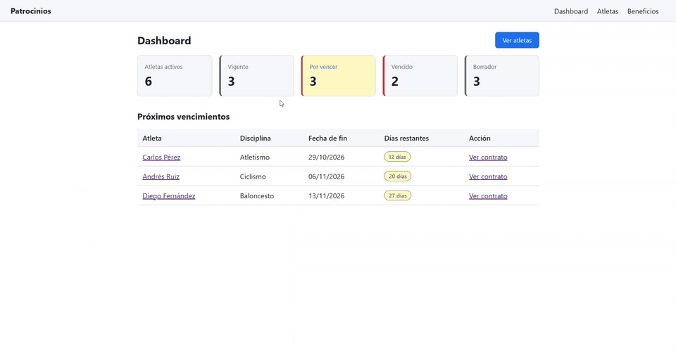
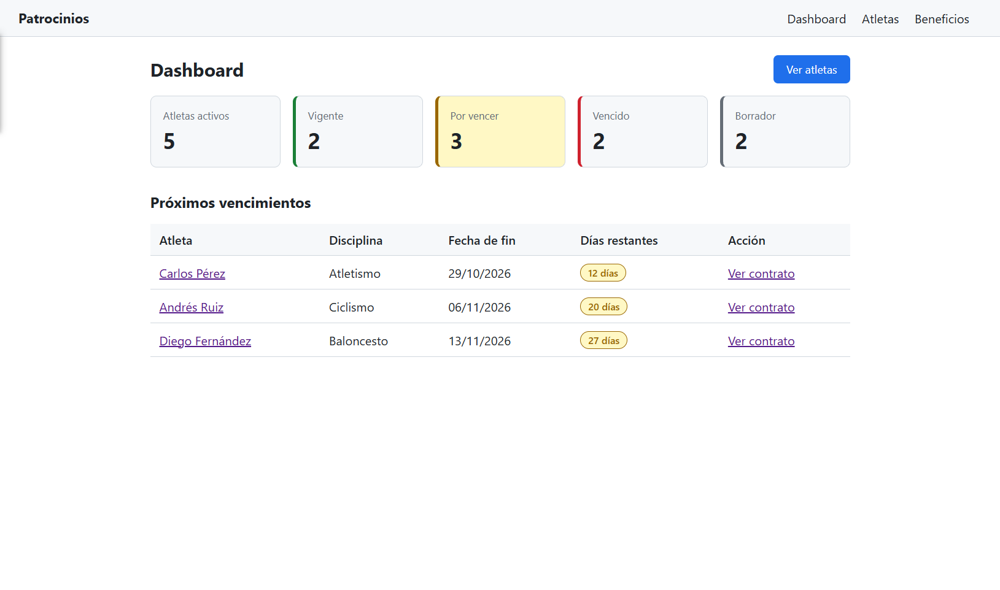
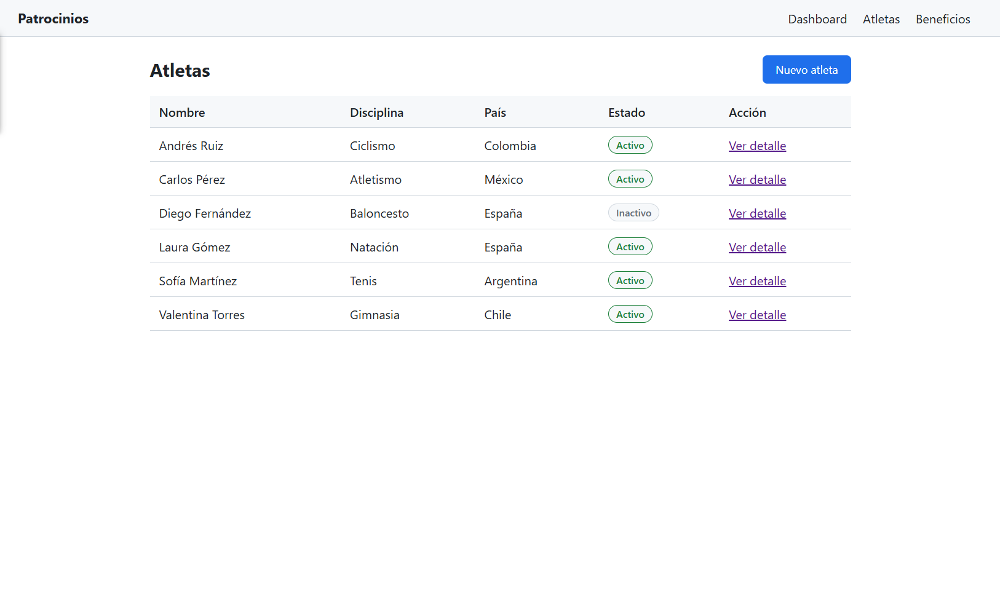
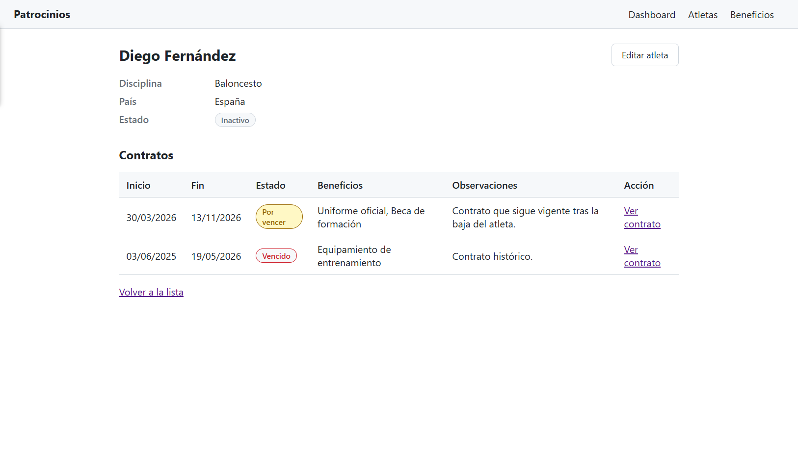
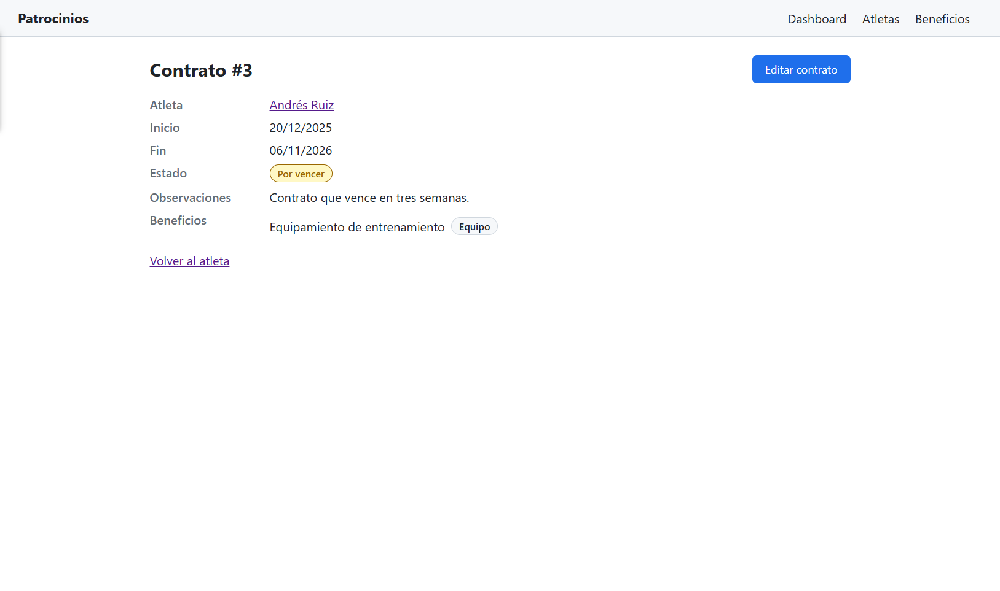
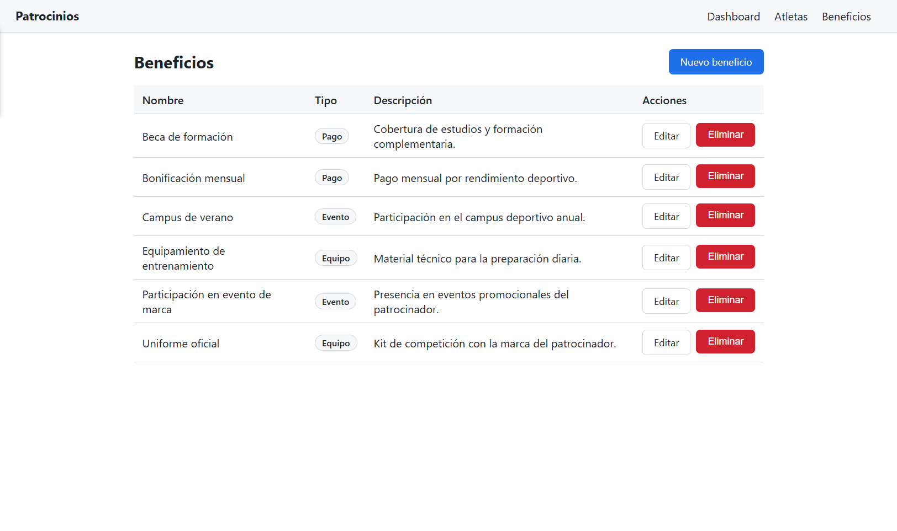

**English** | [Español](README.es.md)

# Athlete Sponsorships Back Office

Internal web system to manage athletes sponsored by a company, their contracts and the associated benefits. It is a portfolio demo built with **Java 21**, **Spring Boot** and **Thymeleaf**, focused on relationship modeling, business rules and the handling of dates and states.

> **Live demo:** it runs on AWS (free plan) and may be turned off to save credits: if it does not respond, watch the GIF below. It has no authentication, so it only contains fictional data. Details in [Deployment](#deployment).

## Screenshots and demo



*Demo walkthrough with fictional data.*

| Dashboard | Athlete list |
|---|---|
|  |  |

| Athlete detail | New contract |
|---|---|
|  |  |

| Contract detail | Benefits |
|---|---|
|  |  |

## What this project demonstrates

- **Relationship modeling with JPA:** Athlete 1:N Contract and Contract N:M Benefit through the `contract_benefit` table.
- **Status derived from dates:** the validity status is not stored, it is calculated with an injected `Clock`. This way the four statuses are never out of date and are tested with fixed dates.
- **Overlap validation** with inclusive ranges, compared against the athlete's contracts that have not expired.
- **Soft delete of athletes and safe deletion of benefits**, to keep the history.
- **A single source of truth for statuses:** the dashboard reuses `ContractService.determineStatus`, so the counts and the upcoming expirations cannot diverge.
- **Aggregate queries and a dashboard** with indicators and a visual alert for upcoming expirations.
- **Tests at two levels:** unit tests of the Services with `Clock.fixed` and integration tests against a local PostgreSQL database.
- **Demo data with relative dates**, which keeps the four statuses represented as time passes.
- **Manual deployment on AWS** (EC2 and RDS), without Docker or CI/CD.

## Features

- Create, view and edit athletes. Athletes with history are not deleted: they become `INACTIVE`. An inactive athlete cannot receive new contracts, but an athlete can be deactivated even with contracts that have not expired.
- Multiple historical contracts per athlete. Every contract has a start date and an end date: there are no open-ended contracts.
- Contract status determined by its dates: `DRAFT`, `IN_FORCE`, `EXPIRING` (between 0 and 30 days left) and `EXPIRED`.
- Validation that prevents contracts whose dates overlap with another contract of the athlete that has not expired.
- Benefits (`EQUIPMENT`, `PAYMENT`, `EVENT`) reusable in several contracts, with editing and safe deletion: only a benefit that is not linked to any contract can be deleted.
- Dashboard with indicators and a list of upcoming expirations with a visual alert.
- Demo data that keeps the four statuses represented as time passes.

## Tech stack

- Java 21 LTS
- Spring Boot, Spring MVC, Spring Data JPA (Hibernate)
- Bean Validation
- Thymeleaf and HTML/CSS
- PostgreSQL
- Maven
- JUnit 5, AssertJ and Mockito
- Lombok (limited use)
- AWS (EC2 and RDS) for the demo, on the free plan

## Architecture

Layered monolith:

```text
Browser
   │
   ▼
Controller   (receives requests, validates forms, returns views)
   │
   ▼
Service      (business rules, statuses by date, overlaps)
   │
   ▼
Repository   (data access with Spring Data JPA)
   │
   ▼
PostgreSQL
```

Views follow the flow `Controller → Thymeleaf → HTML`. Form objects or DTOs are used only when they help to separate the view data from the JPA entities.

## Project structure

```text
docs/           (demo screenshots)

src/main/java/com/example/sponsorships/
├── config/       (ClockConfig, DemoDataLoader)
├── controller/   (Dashboard, Athlete, Contract, Benefit, GlobalExceptionHandler)
├── dto/
├── entity/
├── enums/
├── exception/
├── repository/
└── service/

src/main/resources/
├── application.properties
├── templates/
│   ├── dashboard.html
│   ├── error.html
│   ├── athletes/
│   ├── benefits/
│   ├── contracts/
│   └── fragments/
└── static/
    └── css/
```

## Data model

```text
Athlete 1 ───────── N Contract N ─────── N Benefit
                                  (contract_benefit table)
```

| Entity   | Main fields                                    |
| -------- | ---------------------------------------------- |
| Athlete  | id, fullName, discipline, country, status      |
| Contract | id, athlete, startDate, endDate, notes         |
| Benefit  | id, name, type, description                    |

Controlled values (enums, with a Spanish label for the interface):

- `AthleteStatus`: `ACTIVE` (Activo), `INACTIVE` (Inactivo).
- `ContractStatus`: `DRAFT` (Borrador), `IN_FORCE` (Vigente), `EXPIRING` (Por vencer), `EXPIRED` (Vencido). It is not persisted.
- `BenefitType`: `EQUIPMENT` (Equipo), `PAYMENT` (Pago), `EVENT` (Evento).

A contract cannot exist without an athlete, and a benefit can belong to several contracts.

## Business rules

- A contract end date can never be before its start date.
- An athlete can have several historical contracts, but the dates of a contract cannot overlap with those of another contract that has not expired, including those that have not started yet. The range is inclusive at both ends.
- The validity status is not stored: it is calculated from the contract dates and the current date, taken from an injected `Clock`.
- Contracts cannot be created for an inactive athlete.
- Athletes with history are not deleted: they become `INACTIVE` and keep their contracts.
- A benefit is deleted only if it is not linked to any contract; if it is, a message in Spanish is shown and it is not deleted.
- Text fields have a maximum length: full name 150, discipline and country 100, notes 500, and for benefits name 100 and description 500.

| Status     | Condition                                        |
| ---------- | ------------------------------------------------ |
| `DRAFT`    | Has not started yet (its start date has not arrived) |
| `IN_FORCE` | Has started and has more than 30 days left       |
| `EXPIRING` | Has started and has between 0 and 30 days left   |
| `EXPIRED`  | Its end date has already passed                  |

The dashboard shows the number of **active** athletes; the contract indicators count **all** contracts, regardless of the athlete's status.

## Routes

| Screen                  | Method and route                  |
| ----------------------- | --------------------------------- |
| Dashboard               | `GET /dashboard` (`GET /` redirects) |
| Athlete list            | `GET /athletes`                   |
| Create athlete          | `GET /athletes/new`, `POST /athletes` |
| Athlete detail          | `GET /athletes/{id}`              |
| Edit athlete            | `GET /athletes/{id}/edit`, `POST /athletes/{id}` |
| Create contract         | `GET /athletes/{id}/contracts/new`, `POST /athletes/{id}/contracts` |
| Contract detail         | `GET /contracts/{id}`             |
| Edit contract           | `GET /contracts/{id}/edit`, `POST /contracts/{id}` |
| Benefit list            | `GET /benefits`                   |
| Create benefit          | `GET /benefits/new`, `POST /benefits` |
| Edit benefit            | `GET /benefits/{id}/edit`, `POST /benefits/{id}` |
| Delete benefit          | `POST /benefits/{id}/delete`      |

## How to run it

Requirements: Java 21, Maven and a running PostgreSQL.

1. Clone the repository:

   ```bash
   git clone <repository-url>
   cd athlete-sponsorships-backoffice
   ```

2. Create the databases (one for development and one for tests):

   ```bash
   createdb -h localhost -U postgres sponsorships
   createdb -h localhost -U postgres sponsorships_test
   ```

3. Set the PostgreSQL password without leaving the value in the repository:

   ```bash
   read -rsp "DB_PASSWORD: " DB_PASSWORD && export DB_PASSWORD
   ```

4. Start the application with demo data:

   ```bash
   SPRING_PROFILES_ACTIVE=demo mvn spring-boot:run
   ```

5. Open `http://localhost:8080`.

Without the `demo` profile, the application starts with no data.

### Environment variables

| Variable | Required | Default |
|---|---|---|
| `DB_PASSWORD` | Yes | none |
| `DB_URL` | No | `jdbc:postgresql://localhost:5432/sponsorships` |
| `DB_USERNAME` | No | `postgres` |
| `PORT` | No | `8080` |

Credentials are never stored in the repository.

## Tests

```bash
mvn test
```

- **Unit tests** of the Services with a fixed `Clock`: draft, in force, expiring and expired contracts; end date before start date; overlap with contracts that have not expired (including future ones); a new contract allowed when the previous ones have already expired; form validations; dashboard.
- **Integration tests** of the main persistence cases, against an independent local PostgreSQL database (`sponsorships_test`) with the `test` profile and the schema recreated on each run. They need `DB_PASSWORD` to be set, just like the application.

## Demo scenarios

The application can be demonstrated in a few minutes:

1. **Dashboard:** active athletes, contracts by status and upcoming expirations.
2. **Athlete:** contract history of an athlete.
3. **New contract:** create a contract with dates and several benefits.
4. **Business rule:** try an overlapping contract and see the validation message.
5. **Automatic status:** see how a contract becomes `EXPIRING` according to its end date.

The full script is in [SPECS.md](SPECS.md) §30.

## Technical decisions

- **Status calculated with `Clock`:** the validity status is not persisted in `Contract`. `ContractService.determineStatus` derives it from `startDate`, `endDate` and `LocalDate.now(clock)`, with an injected `Clock` (`ClockConfig`) that is the system clock in production and is fixed with `Clock.fixed` in tests. This way the four statuses are mutually exclusive, are never out of date and are tested without depending on the real day.
- **Inclusive overlap against non-expired contracts:** when creating or editing, the date range is compared (inclusive ends) against the other contracts of the same athlete that are not `EXPIRED` (`DRAFT`, `IN_FORCE` and `EXPIRING`). `DRAFT` contracts count because they will be in force; when editing, the contract itself is excluded.
- **Soft delete of athletes:** athletes with history are not deleted. They are marked as `INACTIVE` and their contracts are kept and still count in the dashboard. An inactive athlete does not accept new contracts.
- **Safe deletion of benefits:** a benefit is deleted only if no contract references it. `BenefitService.delete` checks the link (`existsByBenefitsId`) and throws `BenefitInUseException` with a message in Spanish when it is in use.
- **A single source of truth for statuses:** `DashboardService` reuses `ContractService.determineStatus` and classifies each contract only once, so the counts and the list of upcoming expirations share the same logic and cannot diverge.

## Out of scope

This MVP deliberately does not include: authentication and authorization, roles, audit log, email notifications, external integrations, document upload, digital signature, real payments, public API, microservices, Docker, Redis or messaging, SPA frontend, multi-company support or internationalization. Full list in [SPECS.md](SPECS.md) §3.

## Deployment

The demo is deployed on AWS: an EC2 instance runs the JAR as a `systemd` service and an RDS PostgreSQL database stores the data.

- **Live demo:** http://3.132.35.8/dashboard (HTTP, no certificate, fictional data). Available until April 2027 at most, and it may be turned off to save credits: if it does not respond, watch the GIF above.
- It works with demo data and has no authentication, so it must not be used with real data.
- Configuration comes in through environment variables (`DB_URL`, `DB_USERNAME`, `DB_PASSWORD`, `PORT`); credentials are not versioned.
- Deployment is manual: JAR plus a `systemd` service. It does not use Docker or CI/CD.

## Project documentation

The project documents are written in Spanish.

| File | Content |
|---|---|
| [SPECS.md](SPECS.md) | What is built: scope, rules, model, routes and criteria |
| [CODESTYLE.md](CODESTYLE.md) | How the code is written |
| [ROADMAP.md](ROADMAP.md) | In what order it is built |
| [AGENTS.md](AGENTS.md) | Instructions for AI agents and contributors |

