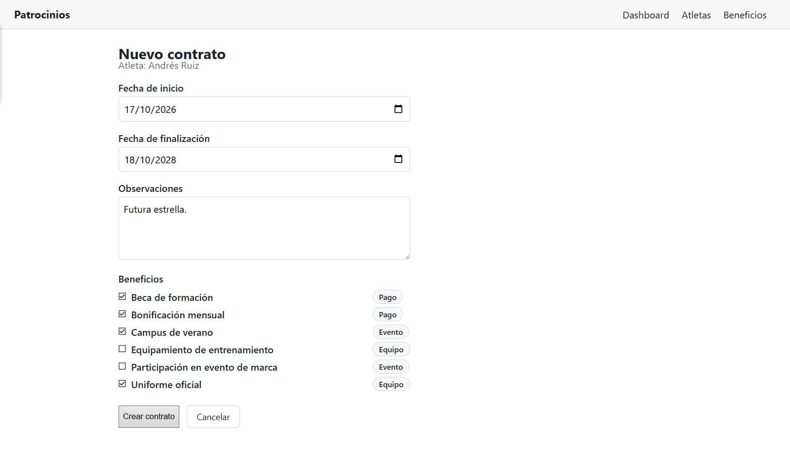

# Backoffice de Patrocinios de Atletas

Sistema web interno para gestionar atletas patrocinados por una empresa, sus contratos y los beneficios asociados. MVP de portafolio construido con **Java 21**, **Spring Boot** y **Thymeleaf**, que pone el foco en el modelado de relaciones, las reglas de negocio y el manejo de fechas y estados.

---

## Funcionalidades

- Registro, consulta y edición de atletas. Los atletas con historial no se eliminan: pasan a `INACTIVE`. Un atleta inactivo no puede recibir nuevos contratos, pero se puede desactivar aunque tenga contratos sin vencer.
- Múltiples contratos históricos por atleta. Todo contrato tiene fecha de inicio y de fin: no existen contratos indefinidos.
- Estado del contrato determinado por sus fechas: `DRAFT`, `IN_FORCE`, `EXPIRING` (faltan entre 0 y 30 días) y `EXPIRED`.
- Validación que impide contratos con fechas solapadas con las de otro contrato del atleta que no haya vencido.
- Beneficios (`EQUIPMENT`, `PAYMENT`, `EVENT`) reutilizables en varios contratos, con edición y eliminación segura: solo se elimina un beneficio que no esté asociado a ningún contrato.
- Dashboard con indicadores y lista de próximos vencimientos con alerta visual.
- Datos de demostración que mantienen representados los cuatro estados con el paso del tiempo.

---

## Stack tecnológico

| Tecnología                  | Uso                                              |
| --------------------------- | ------------------------------------------------ |
| Java 21 LTS                 | Lenguaje principal                               |
| Spring Boot                 | Framework backend                                |
| Spring MVC / Spring Web     | Controladores web                                |
| Spring Data JPA / Hibernate | Persistencia y ORM                               |
| Bean Validation             | Validaciones de formularios                      |
| Thymeleaf                   | Vistas renderizadas en el servidor               |
| Lombok                      | Reducción de código repetitivo (uso acotado)     |
| PostgreSQL                  | Base de datos relacional                         |
| Maven                       | Gestión del proyecto                             |
| JUnit 5, AssertJ y Mockito  | Pruebas (incluidos en Spring Boot Test)          |
| AWS (EC2 y RDS)             | Despliegue de la demo (plan gratuito)            |

---

## Arquitectura

Monolito por capas:

```text
Navegador
   │
   ▼
Controller   (recibe peticiones, valida formularios, devuelve vistas)
   │
   ▼
Service      (reglas de negocio, estados por fecha, solapamientos)
   │
   ▼
Repository   (acceso a datos con Spring Data JPA)
   │
   ▼
PostgreSQL
```

Las vistas siguen el flujo `Controller → Thymeleaf → HTML`. Los objetos de formulario o DTO se usan solo cuando ayudan a separar los datos de la vista de las entidades JPA.

---

## Modelo de dominio

```text
Athlete 1 ───────── N Contract N ─────── N Benefit
                                  (tabla contract_benefit)
```

| Entidad  | Campos principales                             |
| -------- | ---------------------------------------------- |
| Athlete  | id, fullName, discipline, country, status      |
| Contract | id, athlete, startDate, endDate, notes         |
| Benefit  | id, name, type, description                    |

Valores controlados (enums, con etiqueta en español para la interfaz):

- `AthleteStatus`: `ACTIVE` (Activo), `INACTIVE` (Inactivo).
- `ContractStatus`: `DRAFT` (Borrador), `IN_FORCE` (Vigente), `EXPIRING` (Por vencer), `EXPIRED` (Vencido). No se persiste.
- `BenefitType`: `EQUIPMENT` (Equipo), `PAYMENT` (Pago), `EVENT` (Evento).

Un contrato no puede existir sin atleta, y un beneficio puede pertenecer a varios contratos.

---

## Reglas de negocio

- Un fin de contrato nunca puede ser anterior a su inicio.
- Un atleta puede tener varios contratos históricos, pero las fechas de un contrato no pueden solaparse con las de otro que no haya vencido, incluidos los que todavía no inician. El rango es inclusivo en ambos extremos.
- El estado de vigencia no se guarda: se calcula a partir de las fechas del contrato y la fecha actual, obtenida de un `Clock` inyectado.
- No se pueden crear contratos para un atleta inactivo.
- Los atletas con historial no se eliminan: pasan a `INACTIVE` y conservan sus contratos.
- Un beneficio solo se elimina si no está asociado a ningún contrato; si lo está, se muestra un mensaje en español y no se elimina.
- Los campos de texto tienen longitud máxima: nombre completo 150, disciplina y país 100, observaciones 500, y en beneficios nombre 100 y descripción 500.

| Estado     | Condición                                        |
| ---------- | ------------------------------------------------ |
| `DRAFT`    | Todavía no inicia (su fecha de inicio no llega)  |
| `IN_FORCE` | Ya inició y faltan más de 30 días para su fin    |
| `EXPIRING` | Ya inició y faltan entre 0 y 30 días para su fin |
| `EXPIRED`  | Su fecha de fin ya pasó                          |

El dashboard muestra la cantidad de atletas **activos**; los indicadores de contratos cuentan **todos** los contratos, sin importar el estado del atleta.

---

## Pantallas y rutas

| Pantalla                | Método y ruta                     |
| ----------------------- | --------------------------------- |
| Dashboard               | `GET /dashboard` (`GET /` redirige) |
| Lista de atletas        | `GET /athletes`                   |
| Crear atleta            | `GET /athletes/new`, `POST /athletes` |
| Detalle de atleta       | `GET /athletes/{id}`              |
| Editar atleta           | `GET /athletes/{id}/edit`, `POST /athletes/{id}` |
| Crear contrato          | `GET /athletes/{id}/contracts/new`, `POST /athletes/{id}/contracts` |
| Detalle de contrato     | `GET /contracts/{id}`             |
| Editar contrato         | `GET /contracts/{id}/edit`, `POST /contracts/{id}` |
| Lista de beneficios     | `GET /benefits`                   |
| Crear beneficio         | `GET /benefits/new`, `POST /benefits` |
| Editar beneficio        | `GET /benefits/{id}/edit`, `POST /benefits/{id}` |
| Eliminar beneficio      | `POST /benefits/{id}/delete`      |

---

## Capturas de la demo

Capturas de la demo con datos ficticios.





---

## Demo

La aplicación se puede demostrar en pocos minutos:

1. **Dashboard:** atletas activos, contratos por estado y próximos vencimientos.
2. **Atleta:** historial de contratos de un atleta.
3. **Nuevo contrato:** crear un contrato con fechas y varios beneficios.
4. **Regla de negocio:** intentar un contrato solapado y ver el mensaje de validación.
5. **Estado automático:** ver cómo un contrato queda como `EXPIRING` según su fecha de fin.

---

## Cómo ejecutar el proyecto

### Requisitos previos

- Java 21
- Maven
- PostgreSQL en ejecución

### Pasos

```bash
# 1. Clonar el repositorio
git clone <url-del-repositorio>
cd athlete-sponsorships-backoffice

# 2. Crear las bases de datos (la de desarrollo y la de pruebas)
createdb -h localhost -U postgres sponsorships
createdb -h localhost -U postgres sponsorships_test

# 3. Definir la contraseña de PostgreSQL sin dejar el valor en el repositorio
read -rsp "DB_PASSWORD: " DB_PASSWORD && export DB_PASSWORD
# Opcionales (valores por defecto para entorno local):
# export DB_URL=jdbc:postgresql://localhost:5432/sponsorships
# export DB_USERNAME=postgres
# export PORT=8080

# 4. Ejecutar con los datos de demostración
SPRING_PROFILES_ACTIVE=demo mvn spring-boot:run
```

La aplicación quedará disponible en `http://localhost:8080`. `DB_PASSWORD` es obligatoria y no tiene valor por defecto; las credenciales nunca se almacenan en el repositorio.

---

## Despliegue en AWS

La demo está desplegada en AWS: una instancia EC2 ejecuta el JAR como servicio `systemd` y una base RDS PostgreSQL guarda los datos.

- **Demo en vivo:** http://3.132.35.8/dashboard (HTTP, sin certificado, datos ficticios). Disponible como máximo hasta abril de 2027 y puede estar apagada para ahorrar créditos: si no responde, mira el GIF de arriba.
- Funciona con datos de demostración y no tiene autenticación, por lo que no debe usarse con datos reales.
- La configuración entra por variables de entorno (`DB_URL`, `DB_USERNAME`, `DB_PASSWORD`, `PORT`); no se versionan credenciales.
- El despliegue es manual: JAR más servicio `systemd`. No usa Docker ni CI/CD.

---

## Pruebas

- **Unit tests** de los Services con un `Clock` fijo: contrato en borrador, vigente, por vencer y vencido; fecha final anterior a la inicial; solapamiento con contratos que no hayan vencido (incluidos los futuros); contrato nuevo permitido cuando los anteriores ya vencieron; validaciones de formularios; dashboard.
- **Integration tests** de los casos principales de persistencia, contra una base PostgreSQL local independiente (`sponsorships_test`) con el perfil `test` y el esquema recreado en cada ejecución. Requieren `DB_PASSWORD` definido, igual que la aplicación.

```bash
mvn test
```

---

## Decisiones técnicas

- **Estado calculado con `Clock`:** el estado de vigencia no se persiste en `Contract`. `ContractService.determineStatus` lo deriva de `startDate`, `endDate` y `LocalDate.now(clock)`, con un `Clock` inyectado (`ClockConfig`) que en producción es el del sistema y en pruebas se fija con `Clock.fixed`. Así los cuatro estados son mutuamente excluyentes, nunca quedan desactualizados y se prueban sin depender del día real.
- **Solapamiento inclusivo contra contratos no vencidos:** al crear o editar, el rango de fechas se compara (extremos inclusivos) contra los demás contratos del mismo atleta que no estén `EXPIRED` (`DRAFT`, `IN_FORCE` y `EXPIRING`). Los `DRAFT` cuentan porque pasarán a estar en vigor; al editar se excluye el propio contrato.
- **Borrado lógico de atletas:** los atletas con historial no se eliminan. Se marcan como `INACTIVE` y sus contratos se conservan y siguen contando en el dashboard. Un atleta inactivo no admite contratos nuevos.
- **Eliminación segura de beneficios:** un beneficio solo se elimina si ningún contrato lo referencia. `BenefitService.delete` comprueba la asociación (`existsByBenefitsId`) y lanza `BenefitInUseException` con un mensaje en español cuando está en uso.
- **Una sola fuente de verdad para los estados:** `DashboardService` reutiliza `ContractService.determineStatus` y clasifica cada contrato una sola vez, de modo que los conteos y la lista de próximos vencimientos comparten la misma lógica y no pueden divergir.

---

## Estructura del proyecto

```text
docs/           (capturas de la demo)

src/main/java/com/example/sponsorships/
├── config/       (ClockConfig, DemoDataLoader)
├── controller/   (Dashboard, Athlete, Contract, Benefit, GlobalExceptionHandler)
├── dto/
├── entity/
├── enums/
├── exception/
├── repository/
└── service/

src/main/resources/
├── application.properties
├── templates/
│   ├── dashboard.html
│   ├── error.html
│   ├── athletes/
│   ├── benefits/
│   ├── contracts/
│   └── fragments/
└── static/
    └── css/
```

---

## Fuera de alcance

Este MVP no incluye, de forma deliberada: autenticación y autorización, roles, registro de auditoría, notificaciones por correo, integraciones externas, carga de documentos, firma digital, pagos reales, API pública, microservicios, Docker, Redis o mensajería, frontend SPA, sistema multiempresa ni internacionalización.

---

## Objetivo del proyecto

Demostrar, en una aplicación pequeña pero completa, el modelado de entidades y relaciones JPA, CRUD, validaciones, lógica de negocio, manejo de fechas y estados, consultas agregadas y una interfaz empresarial sencilla, con decisiones que se pueden explicar con claridad en una entrevista técnica.
